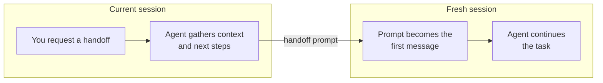

# pi-handoff

Adds a `handoff` tool to [pi](https://pi.dev) so your agent can continue work in a fresh session when you ask it to.



Only the handoff prompt carries over, not the full conversation.

## Install

```sh
pi install git:github.com/tobias-walle/pi-handoff
```

Requires Node.js 24+ and `@earendil-works/pi-coding-agent` with session replacement support. Tested with 1.3.0.

Restart pi or run `/reload`.

## Usage

Ask your agent for a handoff. It writes a prompt and submits it in a fresh session, keeping the current model and reasoning level unless you specify otherwise.

> Do a handoff and implement PLAN.md. Create a new context for every phase.

> Fix all open bug tickets. Do a handoff between each bug to work in a new context. Use openai-codex/gpt-6.1-sol with high reasoning.

> Finish the implementation, then do a handoff to review the changes.

> Do a handoff and review the API for security issues. Name the session "API security review".

> Investigate the failing tests. Do a handoff first and use high reasoning with the current model.

### Tool parameters

The `handoff` tool accepts:

- `prompt`: context and instructions for the new session.
- `title`: optional session name.
- `model`: optional `provider/model-id`.
- `reasoning`: optional `off`, `minimal`, `low`, `medium`, `high`, `xhigh`, or `max`. Must be supported by the selected model.

## Update or remove

```sh
pi update git:github.com/tobias-walle/pi-handoff
pi remove git:github.com/tobias-walle/pi-handoff
```

## Development

```sh
npm ci
npm run check
npm run dev
```
